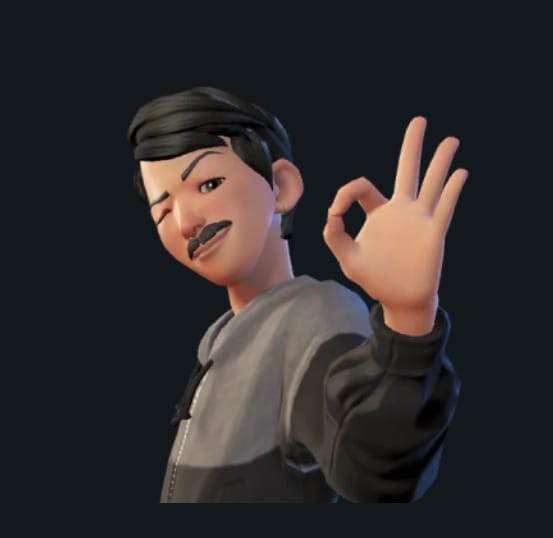
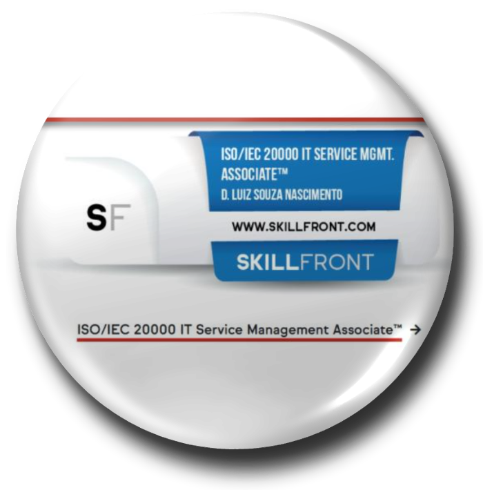
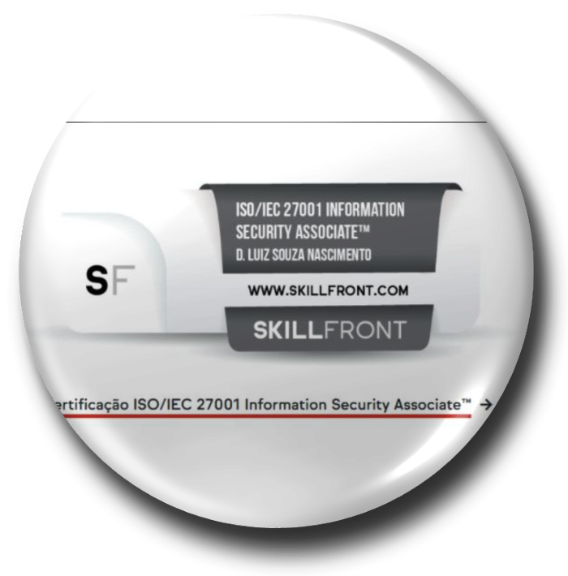
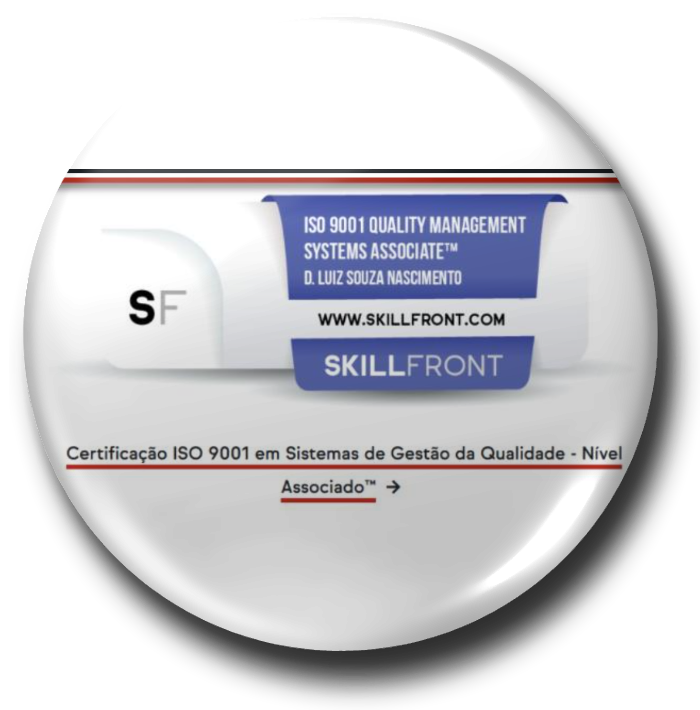

# Davi Luiz Souza

**Full Stack Developer** · Python · Java · API REST

Soluções modernas, escaláveis e de alta qualidade.

---

## Sobre mim

- 🎓 Graduado em **Análise e Desenvolvimento de Sistemas**
- 💼 Desenvolvedor Full Stack na **Faculdade ISCON**
- 🚀 Foco em Back-end com **Python, Django, API Rest, Java e Spring Boot**
- 🌱 Estudando **Docker, AWS, Arquitetura de Software e APIs REST**

## Tech Stack

## Certificações

<table>
  <tr>
    <td align="center">
       
      <b>ISO/IEC 20000</b> Gestão de Serviços de TI
    </td>
    <td align="center">
       
      <b>ISO/IEC 27001</b> Segurança da Informação
    </td>
    <td align="center">
       
      <b>ISO 9001</b> Gestão da Qualidade
    </td>
  </tr>
</table>

---

☕ Café é meu combustível · ⭐ Gostou dos projetos? Deixe uma estrela!

